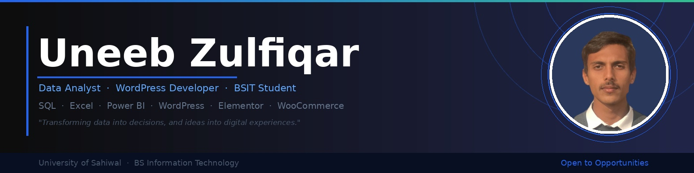
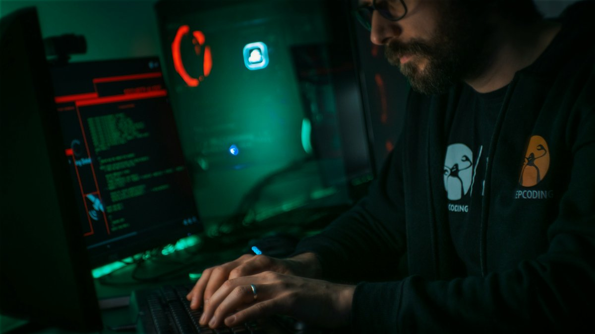

<p align="center">
  
</p>

<h1 align="center">
  
</h1>

<p align="center">
  
  
  
  
</p>

---

## 🧠 About Me

```python
class UneebZulfiqar:
    name       = "Uneeb Zulfiqar"
    role       = "AI & ML Developer | Data Analyst"
    education  = "BS Information Technology — University of Sahiwal"
    location   = "Sahiwal, Punjab, Pakistan 🇵🇰"
    skills     = ["Machine Learning", "Data Analysis", "Python", "SQL", "Power BI"]
    learning   = ["Deep Learning", "LLMs", "Computer Vision"]
    quote      = "Transforming data into decisions, and ideas into digital experiences."
```

---

## 🚀 Tech Stack

### 💻 Languages & Databases


### 🤖 AI / Data Science


### 🌐 Web & API Development


### 🛠️ Tools & Platforms


---

## 🏆 Featured Project

<a href="https://github.com/uneebzulfiqar45-cpu/Job-Rsik-ML">
  
</a>

---

## 💻 Developer Space

<p align="center">
  
</p>

---

## 🌟 What I'm Working On

- 🔭 **Current Focus:** Machine Learning pipelines and AI Automation impact models
- 🌱 **Learning:** Deep Learning architectures & modern NLP frameworks
- 💼 **Available For:** Data Analysis, ML projects & collaborations
- 📫 **Contact:** [uneebzulfiqar45@gmail.com](mailto:uneebzulfiqar45@gmail.com)

---

<p align="center">
  
</p>

<p align="center">
  <b>⭐ Star my repositories if you find my work inspiring! ⭐</b>
</p>
